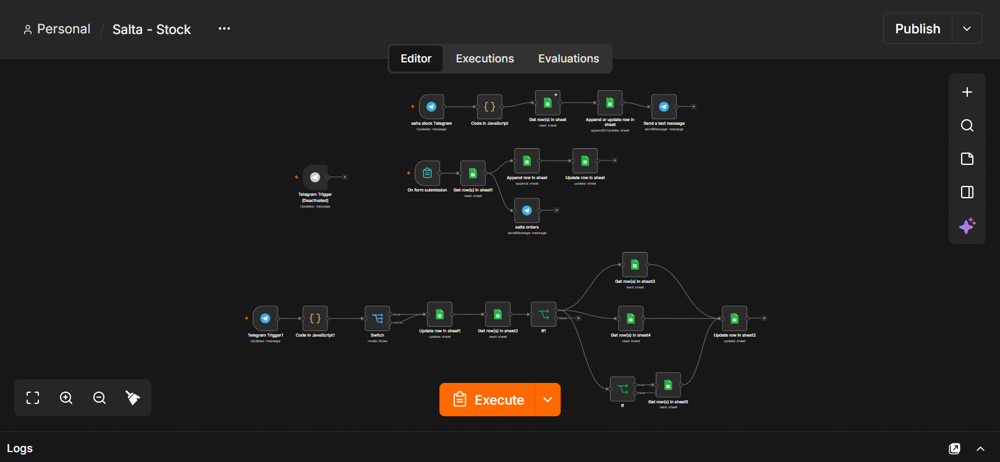
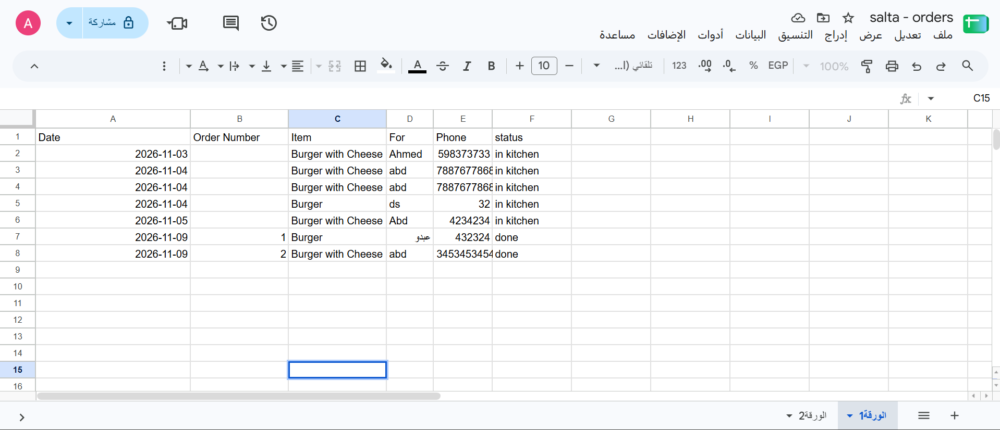
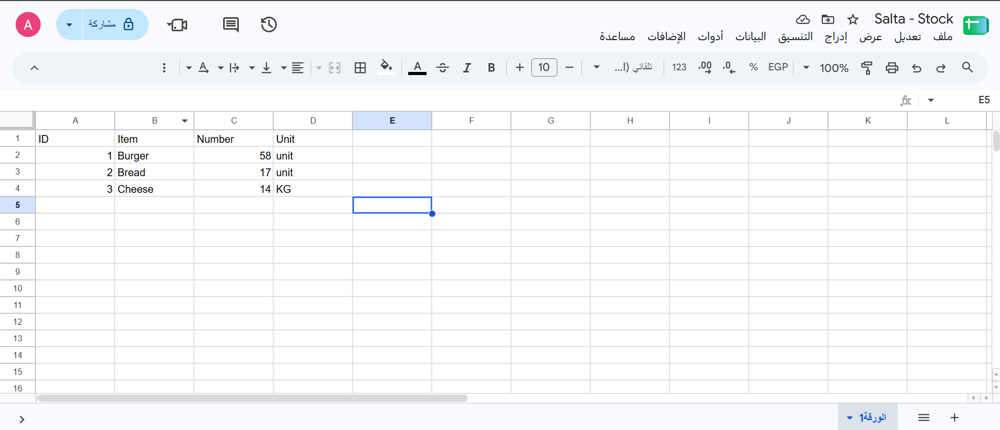

# Restaurant Order & Inventory Management

This is an earlier n8n exercise I worked on while following Engineer Kareem Nabil's lessons 009 and 010. It is kept here as a learning exercise and is separate from RestaurantFlow, which I developed further later as its own project.

The workflow brings together order entry, Telegram messages, Google Sheets, and basic stock updates in one n8n workflow.

## What the workflow does

- Receives a restaurant order through an n8n form.
- Updates the order counter and records the order in Google Sheets.
- Sends a Telegram message with the new order details.
- Accepts Telegram messages to update an order's status.
- Accepts stock quantity updates through Telegram and records them in Google Sheets.
- Includes sample ingredient handling for Burger, Bread, and Cheese.

The workflow contains 22 nodes and keeps the structure of the original lesson exercise rather than being redesigned as a separate system.

## Screenshots

### Workflow overview

### Orders sheet

### Stock sheet

## Import and configuration

The exported JSON has been cleaned before publishing. Personal connection references, webhook IDs, spreadsheet IDs, and the manager's Telegram chat ID have been removed or replaced with placeholders.

Before using it in your own n8n instance:

1. Import the JSON file.
2. Connect your own Telegram and Google Sheets credentials to the relevant nodes.
3. Replace `YOUR_ORDERS_SPREADSHEET_ID` and `YOUR_STOCK_SPREADSHEET_ID` with your spreadsheet IDs.
4. Replace `YOUR_MANAGER_TELEGRAM_CHAT_ID` with the Telegram chat ID that should receive order notifications.
5. Check the sheet names and columns against your Google Sheets files, then test the workflow with sample data.

## A note about the original workflow

This is a lesson-based exercise, not a production-ready restaurant system.

Both `done` and `cancel` commands pass through the same order update path. After updating the order, the workflow checks its status. Ingredient deductions are triggered only when the status is `done`; cancelled orders do not proceed to the stock deduction steps.

---

This exercise is part of my n8n learning work.
