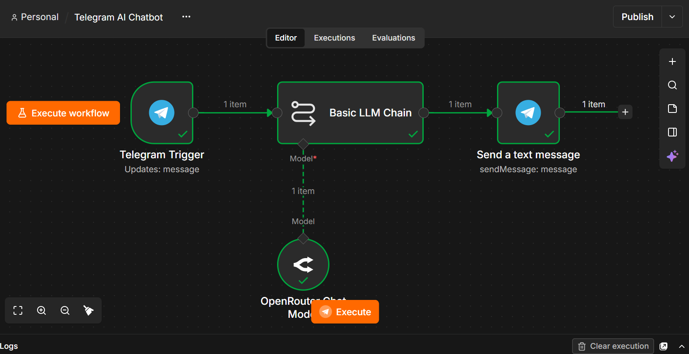
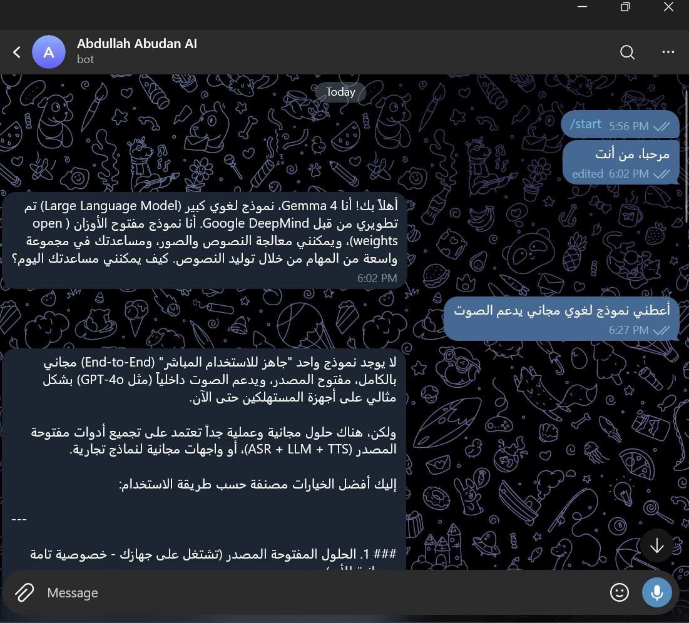

# Telegram AI Chatbot

I built this project to explore AI automation using n8n.

The workflow connects a Telegram bot to an AI model through OpenRouter. When someone sends a message to the bot, the model generates a response and sends it back to Telegram.

## How it works

- **Telegram Trigger:** Receives messages from Telegram.
- **Basic LLM Chain:** Passes the message to the AI model.
- **OpenRouter Chat Model:** Generates a response.
- **Send a text message:** Sends the response back to Telegram.

## Tools used

- n8n
- Telegram Bot API
- OpenRouter

## Setup

1. Import the JSON workflow into n8n.
2. Create a Telegram bot using BotFather.
3. Add your Telegram credentials in n8n.
4. Configure your OpenRouter API key and select an available model.
5. Test the workflow and activate it.

## Screenshots

### Workflow

### Telegram Chat Demo

## Notes

You need your own credentials to run this workflow. Model availability and free usage limits may change.
=======
# n8n-telegram-ai-chatbot
AI-powered Telegram chatbot built with n8n and OpenRouter.