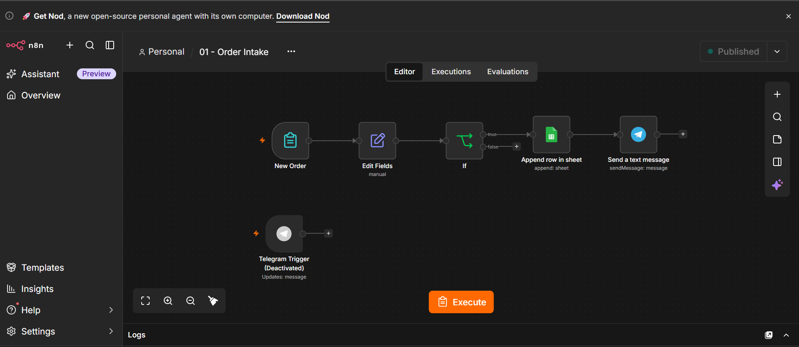
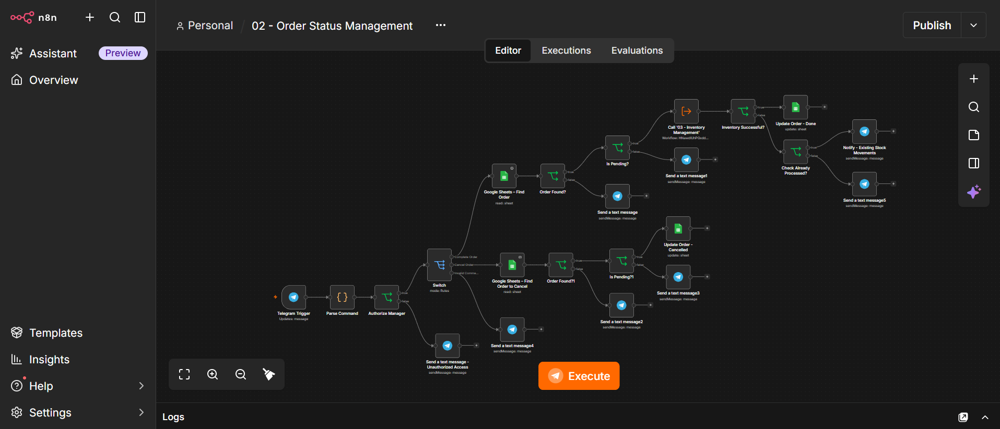
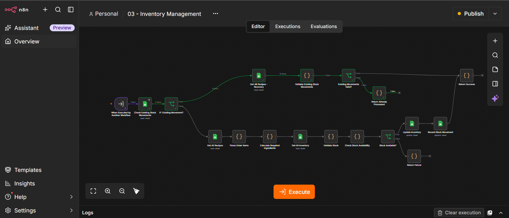
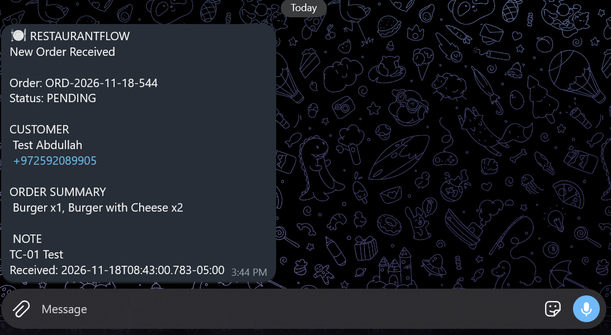
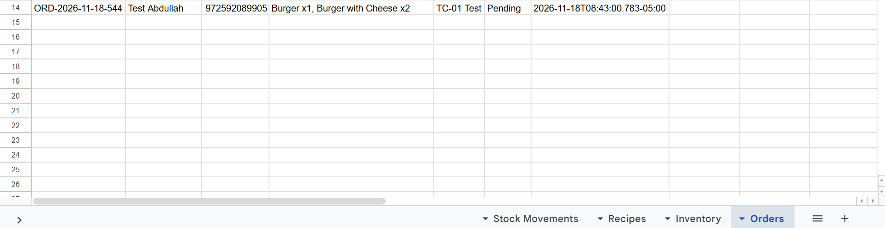

# Restaurant Order & Inventory Automation

RestaurantFlow is an n8n-based automation project designed to simplify restaurant order management and ingredient tracking.

It connects a customer order form, Telegram, and Google Sheets to manage the order lifecycle and keep inventory records up to date.

The project is built around three separate workflows, each responsible for a specific part of the process.

## Project Overview

A restaurant receives orders, processes them, and needs to keep track of the ingredients used in each order. Managing these tasks manually can lead to mistakes, especially when updating order statuses or calculating stock quantities.

RestaurantFlow handles these operations through automated workflows.

The system currently covers three main stages:

1. Receiving and registering customer orders.
2. Managing order completion and cancellation.
3. Calculating ingredient requirements, checking available stock, and recording inventory movements.

## Workflows

### 01 - Order Intake

This workflow handles incoming customer orders.

It collects the customer's information and order details through an n8n form, generates a unique order ID, and saves the order in Google Sheets.

After the order is registered, a Telegram notification is sent to inform the restaurant manager about the new order.

**Main responsibilities:**
- Collect customer details and order information.
- Generate a unique order ID.
- Set the initial order status to `Pending`.
- Save the order in Google Sheets.
- Notify the manager through Telegram.

### 02 - Order Status Management

This workflow allows the restaurant manager to manage existing orders through Telegram commands.

It checks the requested order, verifies that the sender is authorized, and processes the command according to the current order status.

When a manager marks an order as completed, the workflow calls the Inventory Management workflow before updating the order status.

If there is not enough stock, the order remains pending and the manager receives a notification explaining which ingredients are unavailable.

If the order already has recorded stock movements, the inventory workflow verifies them against the ingredient quantities calculated from the recipes. If the recorded movements match the expected quantities, it confirms the previous deduction without updating inventory again, allowing the order status to be updated to `Done`. If the movements are incomplete or do not match, the workflow requests manual review, and the order remains `Pending`.

**Main responsibilities:**
- Receive and parse Telegram commands.
- Verify manager authorization.
- Find the requested order.
- Process completion and cancellation requests.
- Trigger inventory processing before completing an order.
- Verify existing stock movements before allowing an order to be completed.
- Prevent duplicate inventory deductions and request manual review when recorded movements do not match the expected quantities.
- Reject invalid requests and unsupported status changes.

### 03 - Inventory Management

This workflow handles ingredient calculations and stock updates.

When it receives an order, it reads the corresponding recipes, calculates the required quantities for each ingredient, and checks whether the current inventory can cover the order.

If all required ingredients are available, the workflow updates the inventory and records the stock movements in Google Sheets.

If any ingredient is unavailable or insufficient, it returns the relevant information without proceeding with the stock deduction.

Before processing an order, the workflow checks the Stock Movements sheet for existing movements linked to the same order ID. If previous movements are found, it recalculates the expected ingredient quantities from the recipes and compares them with the recorded movements. If they match, the workflow confirms that the inventory was already deducted and returns a successful result without making another deduction. If the movements are incomplete or do not match, it returns a manual review result.

**Main responsibilities:**
- Parse order items and quantities.
- Retrieve product recipes.
- Calculate total ingredient requirements.
- Check available inventory.
- Update ingredient quantities.
- Record stock movements.
- Check for existing stock movements before processing an order.
- Return the processing result to the calling workflow.
- Validate existing stock movements against the expected ingredient quantities.
- Confirm previously processed deductions without updating inventory again.

## How the Workflows Work Together

The three workflows are connected rather than operating independently.

The order status workflow acts as the connection between order management and inventory management.

The general process is:

1. A customer submits an order.
2. The order is saved with a `Pending` status.
3. The manager receives a Telegram notification.
4. The manager requests to complete the order.
5. The system checks the order and sends it to the inventory workflow.
6. The inventory workflow calculates and validates the required ingredients.
7. If stock is sufficient, inventory is updated and the order can be marked as `Done`.
8. If stock is insufficient, the order remains `Pending` and the manager is informed.

## Screenshots

The following screenshots provide a closer look at the main workflows and how the system handles restaurant orders and inventory.

### Workflow Overview

**Order Intake**



**Order Status Management**



**Inventory Management**



### System Operations

**Telegram Order Notification**



**Google Sheets Database**



### Testing

See [TEST-PLAN.md](./TEST-PLAN.md) for test cases, execution results, and evidence.

## Data Storage

Google Sheets is used as the project's initial data storage layer.

The database is organized into four sheets:

| Sheet | Purpose |
|---|---|
| Orders | Stores customer information, order details, and order status. |
| Inventory | Tracks available ingredient quantities and units. |
| Recipes | Defines the ingredients and quantities required for each product. |
| Stock Movements | Records inventory changes associated with orders. |

Keeping recipes and inventory in separate sheets makes it easier to update products and ingredient quantities without changing the workflow logic.

## Technologies Used

- **n8n:** Workflow automation and integration.
- **Telegram Bot API:** Manager notifications and order status commands.
- **Google Sheets:** Order, recipe, inventory, and stock movement records.
- **JavaScript:** Data parsing, calculations, validation, and workflow logic.

## Project Structure

```text
restaurant-order-inventory-automation/
├── README.md
├── screenshots/
└── workflows/
```

The `workflows` directory will contain the exported n8n workflows, while `screenshots` will contain selected images showing the system and its main processes.

## Current Business Rules

The project follows these rules:

- Every new order starts with a `Pending` status.
- Inventory is deducted only when an order is successfully completed.
- An order cannot be completed if the required stock is insufficient.
- Cancelling a pending order does not affect inventory.
- A completed order cannot be cancelled through the current status management flow.

## Testing

The workflows were tested using different order scenarios to check the order status and inventory behavior.

| Test | Result |
|---|---|
| Order with sufficient stock | The order was marked as `Done`, and the required ingredient quantities were deducted from inventory. |
| Order with insufficient stock | The order remained `Pending`, and the manager received an insufficient stock notification. |
| Reprocessing an order with existing stock movements | The workflow stopped the repeated deduction, and the manager received a manual review notification. |

All three test scenarios produced the expected results.

## Setup and Configuration

To run this project, you need:

- A self-hosted n8n instance.
- A Telegram bot created through BotFather.
- A Google account with access to Google Sheets.
- The required Telegram and Google Sheets credentials configured in n8n.

The workflow exports and configuration instructions will be maintained in this repository.

**Important:** Credentials, bot tokens, personal chat IDs, and other private configuration values must not be included in the exported workflow files.

## Current Status

The project is under development.

The three main workflows have been created and connected. Further work focuses on improving the customer ordering experience, testing different order scenarios, and strengthening the reliability of inventory updates.

## Reliability and Limitations

The workflow checks for existing stock movements to prevent duplicate inventory deductions when an order is processed again.

However, Google Sheets does not support database transactions. A workflow failure during inventory updates may leave some records updated while others are not. Processing multiple orders at the same time may also cause inventory inconsistencies.

These cases may require manual review and inventory reconciliation.

## Future Improvements

- Provide a more convenient way for customers to select products and quantities.
- Improve Telegram notifications and manager interactions.
- Add more comprehensive error handling.
- Test repeated commands and unexpected execution failures.
- Improve inventory consistency when multiple orders are processed close together.
- Expand the system with more products and restaurant configurations.

---

Built as a hands-on project to explore workflow automation, API integrations, data handling, and practical business process improvement.